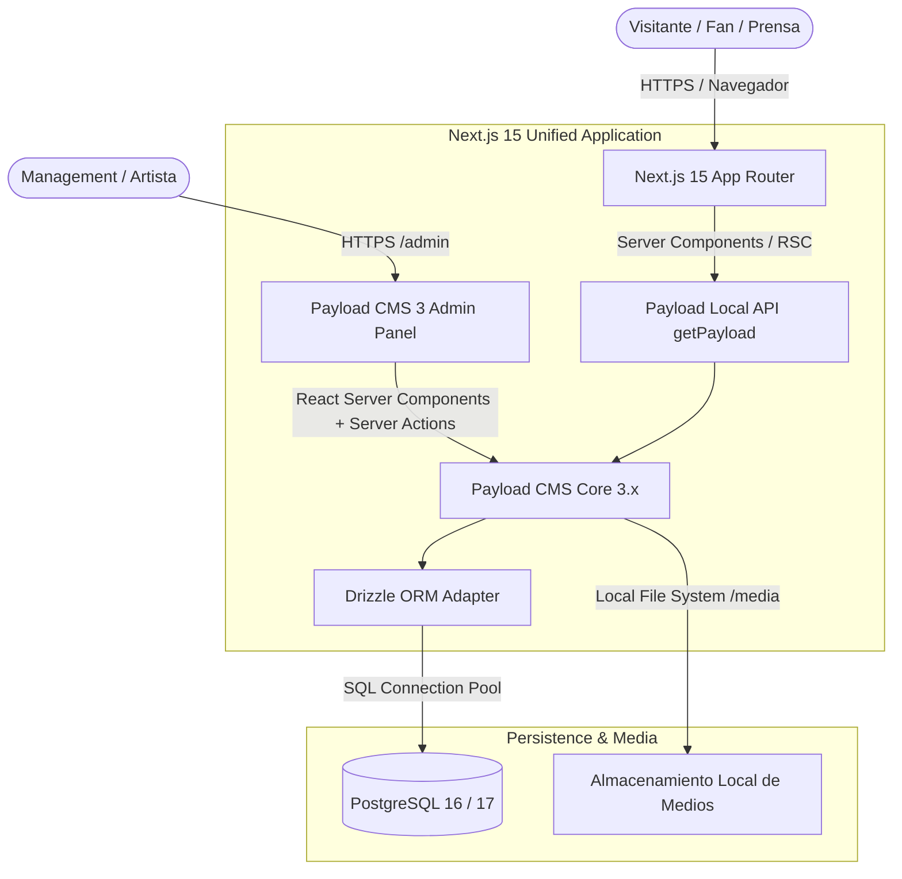
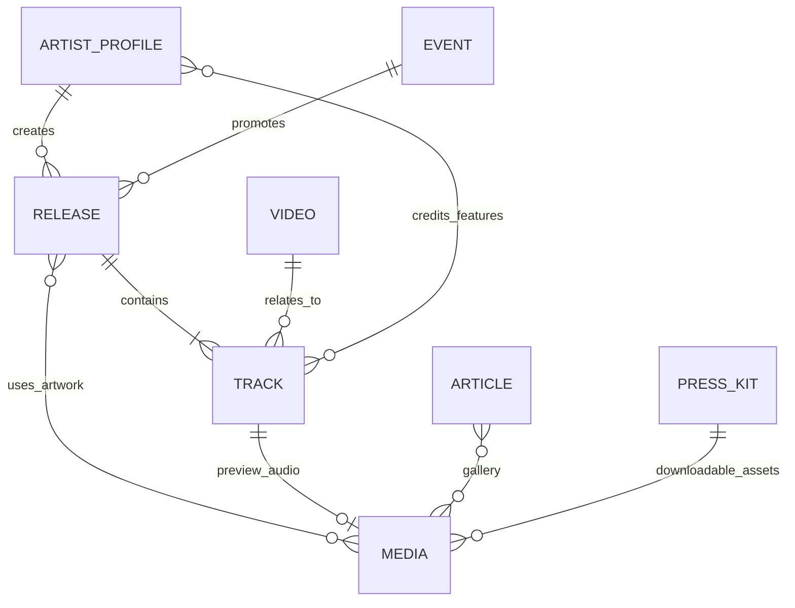

# 02 — Arquitectura del Sistema y Contenido

## 1. Visión General de la Arquitectura

La plataforma **Dany Glock — Artist Digital Experience** se concibe bajo una arquitectura de **Monolito Moderno Unificado**, integrando en una única base de código:
1. **Frontend Público de Alta Fidelidad:** Desarrollado con Next.js 15 (App Router), React 19 y Server Components.
2. **Sistema de Gestión de Contenidos (CMS):** Payload CMS 3.x ejecutándose de manera nativa dentro del propio Next.js en la ruta `/admin`.
3. **Capa de Persistencia Relacional:** PostgreSQL gestionado a través del adaptador oficial `@payloadcms/db-postgres` (basado en Drizzle ORM).



---

## 2. Comparativa: Arquitectura Recomendada vs Astro + CMS Desacoplado

Tal como se solicitó en el análisis técnico, contrastamos la solución recomendada con la alternativa de **Astro con CMS desacoplado** (por ejemplo, Astro + Strapi / Directus / Sanity):

| Criterio | Solución Recomendada: Next.js 15 + Payload 3 Nativo | Alternativa: Astro + CMS Desacoplado | Veredicto y Justificación |
| :--- | :--- | :--- | :--- |
| **Arquitectura de Repositorio y Despliegue** | **Monorepo / Monolito Unificado:** 1 solo proyecto, 1 solo `package.json`, 1 solo proceso de Node.js a gestionar en el VPS. | **Multi-servicio Desacoplado:** Requiere gestionar 2 servidores independientes (Frontend Astro + Backend CMS Strapi/Directus). | **Gana Next.js + Payload 3:** Simplifica drásticamente el mantenimiento local y el despliegue en un VPS único sin sobrecargar memoria RAM. |
| **Latencia de Acceso a Datos** | **Zero-Network Overhead:** Las páginas públicas consultan la base de datos a través de la `Local API` de Payload directamente en el servidor sin peticiones HTTP intermedias. | **Network Overhead:** Cada build o petición en servidor debe hacer llamadas HTTP REST o GraphQL hacia el CMS externo. | **Gana Next.js + Payload 3:** Mayor velocidad de renderizado y menor fragilidad de red. |
| **Sincronización de Tipos TypeScript** | **100% End-to-End:** Las colecciones de Payload generan automáticamente `payload-types.ts`. Los componentes del frontend consumen los tipos exactos sin duplicar interfaces. | **Tipado Manual o Generadores Externos:** Requiere esquemas GraphQL o herramientas externas de sincronización de tipos. | **Gana Next.js + Payload 3:** Mantenibilidad y seguridad de tipos inigualable. |
| **Libertad Creativa y Animaciones Complejas** | **Excelente:** Soporte total para GSAP ScrollTrigger, Lenis y Motion en React. Ecosistema de animación maduro para transiciones de página complejas. | **Buena:** Astro soporta "View Transitions" y componentes React mediante islas, pero coordinar estados de audio global persistente y timelines de GSAP entre islas añade fricción. | **Gana Next.js:** Para una experiencia cinematográfica con reproductor flotante persistente e interacción editorial continua, React/Next.js ofrece mayor control. |
| **Simplicidad de Administración (CMS)** | **Excelente:** Panel `/admin` moderno, extensible con componentes React, previsualización en vivo (Live Preview) en tiempo real con Next.js. | **Variable:** Paneles de CMS externos son potentes pero su previsualización en vivo con Astro requiere webhooks y configuraciones complejas. | **Gana Next.js + Payload 3:** La previsualización en vivo integrada acelera el trabajo editorial del management. |
| **Rendimiento Inicial (SEO & HTML Estático)** | **Excelente:** Next.js 15 genera HTML en el servidor (RSC) con soporte de caché estática incremental (ISR). | **Sobresaliente:** Astro genera cero JS por defecto si no se usan islas. | **Ventaja ligera Astro en sitios planos, pero Next.js 15 con RSC iguala el rendimiento en contenido dinámico.** |

### Conclusión de la Comparativa:
Astro es excelente para blogs o sitios de contenido puramente estático. Sin embargo, para **Dany Glock**, donde se requiere un **reproductor de música flotante continuo**, **animaciones cinematográficas sincronizadas con el scroll**, un **Electronic Press Kit interactivo** y un **panel administrativo completamente integrado que pueda desplegarse en un único VPS sin administrar dos aplicaciones independientes**, **Next.js 15 con Payload CMS 3.x es la solución más robusta, limpia y libre de sobreingeniería**.

---

## 3. Modelo Conceptual de Contenido

El modelo de contenido se organiza en **Colecciones** (entidades repetitivas con múltiples registros) y **Globals** (entidades únicas de configuración global):



### 3.1. Colecciones

#### 1. `releases` (Lanzamientos Musicales)
- **Propósito:** Catálogo oficial de discografía (Álbumes, EPs, Mixtapes, Singles).
- **Campos Esenciales:**
  - `title` (Texto, Requerido).
  - `slug` (Texto, Requerido, Único, Indexado).
  - `type` (Select: `album`, `ep`, `single`, `mixtape`).
  - `releaseDate` (Fecha, Requerida).
  - `coverImage` (Relación a `media`, Requerida).
  - `description` (RichText / Editorial).
  - `streamingLinks` (Grupo: Spotify, Apple Music, YouTube Music, Tidal, Amazon Music, Deezer).
  - `featured` (Booleano: para destacar en la Home/Hero).
  - `tracks` (Array o relación uno a muchos con `tracks`).
  - `status` (Select: `draft`, `published`, `archived`).

#### 2. `tracks` (Canciones y Pistas)
- **Propósito:** Registro individual de canciones con metadata técnica, letras y audio.
- **Campos Esenciales:**
  - `title` (Texto, Requerido).
  - `release` (Relación a `releases`).
  - `trackNumber` (Número).
  - `duration` (Texto o segundos, ej. "3:42").
  - `audioPreview` (Relación a `media` para escucha previa en reproductor flotante).
  - `spotifyUrl`, `appleMusicUrl`, `youtubeUrl` (URLs directas a la canción).
  - `lyrics` (Texto enriquecido / Letra oficial con saltos de estrofa).
  - `credits` (Grupo: Productores, Compositores, Ingenieros de Mezcla y Master, Artistas invitados / Features).
  - `isrcCode` (Texto opcional: código estándar internacional de grabación).
  - `featured` (Booleano).

#### 3. `videos` (Videoclips & Audiovisual)
- **Propósito:** Videografía oficial, directos y visualizers.
- **Campos Esenciales:**
  - `title` (Texto, Requerido).
  - `slug` (Texto, Requerido, Único).
  - `type` (Select: `official_music_video`, `live_session`, `visualizer`, `behind_the_scenes`).
  - `youtubeUrl` (URL, Requerido, para embed optimizado y extracción de ID).
  - `customThumbnail` (Relación a `media` para póster cinematográfico custom).
  - `releaseDate` (Fecha).
  - `relatedTrack` (Relación a `tracks`, opcional).
  - `director` (Texto).
  - `cinematographer` (Texto).
  - `featured` (Booleano: video principal en sección audiovisual).

#### 4. `events` (Conciertos & Giras)
- **Propósito:** Fechas de shows en vivo, festivales y giras mundiales/locales.
- **Campos Esenciales:**
  - `eventName` (Texto, Requerido, ej. "Dany Glock Live — CDMX").
  - `date` (Fecha y Hora, Requerido).
  - `city` (Texto, Requerido).
  - `country` (Texto, Requerido).
  - `venue` (Texto, Requerido, ej. "Pepsi Center WTC").
  - `ticketStatus` (Select: `available`, `sold_out`, `presale`, `free`, `cancelled`).
  - `ticketUrl` (URL externa a boletería oficial).
  - `vipPackageUrl` (URL opcional para accesos VIP / Meet & Greet).
  - `posterImage` (Relación a `media`, opcional).

#### 5. `articles` (Journal / Noticias / Comunicados)
- **Propósito:** Cobertura de prensa, notas editoriales, lanzamientos y diario del artista.
- **Campos Esenciales:**
  - `title` (Texto, Requerido).
  - `slug` (Texto, Requerido, Único).
  - `category` (Select: `news`, `editorial`, `interview`, `press_release`).
  - `publishedAt` (Fecha).
  - `heroImage` (Relación a `media`).
  - `excerpt` (Texto corto para tarjetas y meta descripción SEO).
  - `content` (RichText Lexical con soporte de imágenes y citas editoriales).
  - `status` (Select: `draft`, `published`).

#### 6. `media` (Archivos Multimedia y Assets)
- **Propósito:** Gestión centralizada de fotografías de alta resolución, audio de preview, pósters y PDFs.
- **Campos Esenciales:**
  - `alt` (Texto descriptivo para accesibilidad y SEO, Requerido).
  - `caption` (Texto opcional).
  - `category` (Select: `artwork`, `photo_shoot`, `press_photo`, `audio_preview`, `document`).
  - `isPressAsset` (Booleano: marca el archivo como disponible para descarga en el Press Kit).

#### 7. `contacts` (Mensajes de Contacto & Booking)
- **Propósito:** Registro seguro de solicitudes recibidas desde la web.
- **Campos Esenciales:**
  - `fullName` (Texto).
  - `email` (Email).
  - `phone` (Texto, opcional).
  - `subjectType` (Select: `booking_event`, `press_media`, `brand_partnership`, `other`).
  - `message` (Texto largo).
  - `status` (Select: `new`, `contacted`, `archived`).

---

### 3.2. Globals (Configuraciones Globales Únicas)

#### 1. `artist-profile`
- Manifiesto artístico principal.
- Biografía en 3 formatos:
  - *Short Bio* (para redes y fichas de festivales — ~50 palabras).
  - *Medium Bio* (para la Home y notas de prensa — ~150 palabras).
  - *Full Editorial Bio* (para la página de Biografía oficial — narrativa extendida).
- Citas destacadas de la crítica musical (*Press Quotes*).
- Fotos oficiales de firma.

#### 2. `site-settings`
- Metadatos SEO globales (Título por defecto, descripción, Open Graph image, Twitter card).
- Enlaces oficiales de streaming (Spotify Artist ID, Apple Music, YouTube Channel, SoundCloud).
- Redes sociales oficiales (Instagram, TikTok, X, Discord).
- Contactos oficiales de management (Booking agency, Legal, PR).
- Textos de copyright y avisos legales.

---

## 4. Estrategia de Estados de Publicación y Drafts

Payload CMS 3 cuenta con soporte nativo de `drafts` y control de versiones:
- **Colecciones con Drafts:** `releases`, `articles`, `events`.
- **Previsualización en Vivo:** Integrada con Next.js Draft Mode (`/api/draft`). Permite al management previsualizar cómo se verá un nuevo lanzamiento antes de hacerlo público, con hot-reload en tiempo real sin salir del navegador.

---

## 5. Arquitectura de Despliegue en VPS (Hoja de Ruta Futura)

Aunque en esta misión **no se configurará despliegue productivo**, la arquitectura elegida está optimizada para desplegarse limpiamente en un VPS de OVHcloud:
- **Contenedor Único / Proceso Node:** Next.js ejecuta tanto el frontend como el CMS en un único puerto interno (ej. `3000`).
- **Reverse Proxy Nginx:** Gestión de certificados SSL (Let's Encrypt), compresión gzip/brotli y proxy hacia el puerto `3000`.
- **PostgreSQL Local o Gestionado:** Instancia local de PostgreSQL 16/17 securizada con autenticación estricta por socket o localhost.
- **Persistencia de Medios:** Volumen montado para la carpeta `/media` o almacenamiento en bucket S3 en caso de escalar.

---

## 6. Estructura de Carpetas Recomendada

Para el proyecto unificado en Next.js 15 App Router y Payload CMS 3, se define la siguiente arquitectura de directorios:

```text
dany-glock/
├── .agents/                        # Configuración y skills del agente Antigravity
│   └── skills/                     # Skills del workspace (dark-cinematic-ui, payload-3, etc.)
├── local/                          # Espacio de trabajo local persistente
│   └── _ai-workspace/              # Project Brain (documentación viva, arquitectura, backlog)
├── public/                         # Archivos estáticos públicos (favicon, texturas, logos)
│   ├── fonts/                      # Fuentes Display / Sans optimizadas (WOFF2)
│   ├── textures/                   # Grano de película (film-grain.svg / png)
│   └── icons/
├── src/
│   ├── app/                        # Next.js 15 App Router
│   │   ├── (payload)/              # Rutas del panel CMS y endpoints de Payload
│   │   │   ├── admin/              # Panel de control de administración (/admin)
│   │   │   └── api/                # Endpoints GraphQL / REST / Drafts de Payload
│   │   ├── (public)/               # Rutas de la experiencia pública del artista
│   │   │   ├── layout.tsx          # Root Layout (SmoothScrollProvider, Nav, Player, Footer)
│   │   │   ├── page.tsx            # Home (Hero Showcase, Top Tracks, Tour Teaser, News)
│   │   │   ├── bio/                # Biografía y manifiesto editorial
│   │   │   ├── discografia/        # Catálogo de lanzamientos y canciones
│   │   │   │   └── [slug]/         # Ficha detallada de álbum/single (tracklist, letras)
│   │   │   ├── videos/             # Galería audiovisual y directos
│   │   │   ├── tour/               # Calendario de conciertos y venta de tickets
│   │   │   ├── journal/            # Noticias y comunicados editoriales
│   │   │   │   └── [slug]/         # Artículo editorial
│   │   │   ├── press-kit/          # Electronic Press Kit (EPK) interactivo y descargas
│   │   │   └── contacto/           # Formularios de booking y prensa
│   │   └── not-found.tsx           # Error 404 cinematográfico
│   ├── collections/                # Definiciones de colecciones de Payload CMS
│   │   ├── Releases.ts             # Álbumes, EPs y Singles
│   │   ├── Tracks.ts               # Canciones, letras, créditos y audio preview
│   │   ├── Videos.ts               # Videoclips y directos
│   │   ├── Events.ts               # Shows y giras
│   │   ├── Articles.ts             # Noticias y journal
│   │   ├── Media.ts                # Archivos e imágenes optimizadas
│   │   ├── Contacts.ts             # Mensajes recibidos
│   │   └── Users.ts                # Usuarios administradores
│   ├── globals/                    # Configuraciones globales de Payload CMS
│   │   ├── ArtistProfile.ts        # Biografías en 3 tamaños, citas y manifiesto
│   │   └── SiteSettings.ts         # Redes, enlaces de streaming y SEO por defecto
│   ├── components/                 # Componentes de interfaz de usuario
│   │   ├── layout/                 # Navegación cinematográfica, Footer, Menú lateral
│   │   ├── player/                 # Reproductor de audio flotante persistente
│   │   ├── visual/                 # Film grain shader, viñetas, halos de luz
│   │   ├── kinetic/                # Componentes interactivos animados (GSAP / Motion)
│   │   └── ui/                     # Primitivas accesibles (Radix UI / botones con token)
│   ├── hooks/                      # Custom React hooks (useAudioPlayer, useReducedMotion)
│   ├── lib/                        # Utilidades y clientes
│   │   ├── payload.ts              # Cliente singleton de Payload Local API
│   │   ├── utils.ts                # Formateo de fechas, duraciones y clases (clsx/twMerge)
│   │   └── lenis.ts                # Sincronización Lenis + GSAP
│   ├── styles/                     # Estilos globales y tokens
│   │   └── globals.css             # Tailwind base + CSS Custom Properties (Dark Cinematic)
│   ├── payload.config.ts           # Archivo de configuración central de Payload 3
│   └── payload-types.ts            # Tipos TypeScript autogenerados por Payload
├── .env.example                    # Plantilla de variables de entorno (DATABASE_URL, PAYLOAD_SECRET)
├── .gitignore                      # Exclusiones de Git (node_modules, .next, etc.)
├── AGENTS.md                       # Protocolo de entrada para agentes IA
├── AGENT-RULES.md                  # Reglas permanentes y estándares de calidad
├── next.config.ts                  # Configuración de Next.js con withPayload()
├── package.json                    # Dependencias y scripts
├── tailwind.config.ts              # Configuración de Tailwind y tokens de diseño
├── tsconfig.json                   # Configuración estricta de TypeScript
└── vitest.config.ts                # Configuración de pruebas unitarias
```

