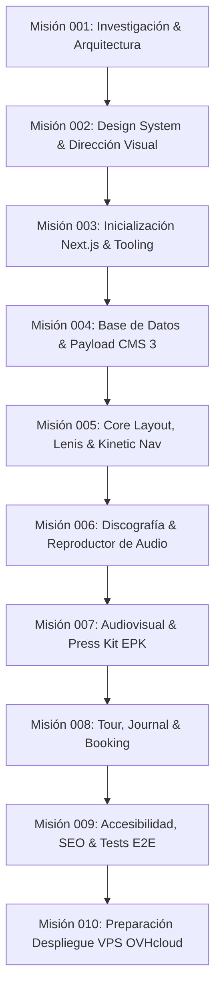

# 07 — Hoja de Ruta (Roadmap) por Misiones Atómicas

El desarrollo del proyecto **Dany Glock — Artist Digital Experience** se estructura en **10 misiones atómicas, secuenciales y comprobables**, diseñadas para garantizar avance continuo sin deuda técnica ni sobreingeniería.

---

---

## Detalle de Misiones

### ✅ Misión 001 — Investigación técnica, arquitectura y preparación del proyecto *(Completada)*
- **Objetivo:** Definir fundamentos, validar viabilidad técnica, auditar entorno, establecer reglas operativas y Project Brain.
- **Entregables:** Diagnóstico de entorno, comparativa de stack, modelos conceptuales de contenido, ADRs iniciales, reglas para agentes y Project Brain inicial en `local/_ai-workspace/`.

---

### ⏳ Misión 002 — Design System, tokens y dirección visual
- **Objetivo:** Establecer la especificación visual y componentes base del concepto *Dark Cinematic Editorial*.
- **Alcance:**
  - Definición completa de tokens de diseño (tipografías, escala modular, paleta de colores cromática y neutra, elevaciones, bordes y espaciados).
  - Especificación de curvas cinemáticas de animación y micro-interacciones.
  - Creación de guías de accesibilidad de contraste y foco para entornos oscuros.
  - Prototipos conceptuales de componentes primarios (Hero Card, Track Row, Event Pill, Media Badge, Player Bar).

---

### ⏳ Misión 003 — Inicialización del proyecto y tooling
- **Objetivo:** Crear el andamiaje del proyecto Next.js 15 con TypeScript y herramientas de desarrollo limpias.
- **Alcance:**
  - Creación del proyecto base con `pnpm` y Next.js 15 App Router.
  - Configuración de TypeScript en modo estricto.
  - Configuración de Tailwind CSS v3.4 con tokens semánticos del Design System.
  - Integración de Vitest y Testing Library para pruebas unitarias.
  - Configuración de linters, formato de código y estructura de carpetas profesional.

---

### ⏳ Misión 004 — Base de datos y Payload CMS 3.x
- **Objetivo:** Integrar el panel de administración y modelar las entidades de datos en PostgreSQL.
- **Alcance:**
  - Instalación y configuración de Payload 3.x nativo en `/admin`.
  - Conexión del adaptador `@payloadcms/db-postgres` con PostgreSQL 17 local.
  - Implementación de las colecciones (`releases`, `tracks`, `videos`, `events`, `articles`, `media`, `contacts`).
  - Implementación de los globals (`artist-profile`, `site-settings`).
  - Configuración de autenticación de administradores y roles.
  - Carga de datos iniciales (*seed data*) representativos del artista.

---

### ⏳ Misión 005 — Core Layout, Smooth Scroll & Kinetic Navigation
- **Objetivo:** Desarrollar el marco estructural envolvente de la experiencia pública.
- **Alcance:**
  - Root Layout con integración de Server Components y tipografías personalizadas.
  - Implementación del proveedor de smooth scroll inercial con Lenis y ticker de GSAP.
  - Barra de navegación flotante cinemática con efectos de blur y estado adaptativo al scroll.
  - Menú lateral editorial desplegable con transiciones de Motion.
  - Footer cinematográfico con créditos, redes sociales y manifiesto.

---

### ⏳ Misión 006 — Discografía, reproductor y lanzamientos
- **Objetivo:** Construir la experiencia musical central para los fans.
- **Alcance:**
  - Hero Showcase del último lanzamiento con preview audiovisual y CTAs de streaming.
  - Catálogo de discografía con filtros por tipo (Álbum, EP, Single).
  - Ficha detallada de lanzamiento con carátula fija (*pinned scroll*), tracklist y créditos.
  - Reproductor de audio flotante persistente con control de reproducción, volumen, scrubber y visualizador de onda sonora accesible.

---

### ⏳ Misión 007 — Audiovisual, videoclips y Electronic Press Kit (EPK)
- **Objetivo:** Presentar el universo visual del artista y herramientas para la prensa y medios.
- **Alcance:**
  - Galería de videoclips con reproductor modal optimizado y créditos de dirección.
  - Sección interactiva de Electronic Press Kit (EPK).
  - Descargas de fotos de prensa en alta resolución con previsualización rápida.
  - Biografía oficial descargable en PDF y versiones de texto para programas de festivales.

---

### ⏳ Misión 008 — Eventos / Tour, Journal y Booking / Contacto
- **Objetivo:** Gestionar presentaciones en vivo, noticias y canal directo de negocio.
- **Alcance:**
  - Calendario de conciertos y festivales con estado de tickets (*Sold Out*, *Preventa*).
  - Journal editorial con artículos y comunicados oficiales.
  - Formulario de contacto segmentado (Booking, Prensa, Patrocinios) con validación estricta y protección anti-spam.

---

### ⏳ Misión 009 — Optimización, accesibilidad (a11y), SEO y pruebas E2E
- **Objetivo:** Pulir y certificar la calidad integral de la plataforma antes del empaquetado final.
- **Alcance:**
  - Auditoría completa de accesibilidad WCAG 2.1 AA con Playwright y axe-core.
  - Optimización de Core Web Vitals (LCP < 2s, CLS < 0.05).
  - Metadatos OpenGraph, Twitter Cards, Schema.org de tipo `MusicGroup` y `MusicAlbum`.
  - Verificación estricta de `prefers-reduced-motion` en todos los navegadores.

---

### ⏳ Misión 010 — Preparación de despliegue en VPS (OVHcloud)
- **Objetivo:** Dejar la plataforma empaquetada y documentada para su puesta en producción sin complicaciones.
- **Alcance:**
  - Generación de `Dockerfile` multi-stage optimizado para Next.js en modo standalone.
  - Configuración de script de migraciones de PostgreSQL para entorno de producción.
  - Archivo de configuración modelo para Nginx (Reverse Proxy + SSL Let's Encrypt).
  - Manual operativo de despliegue, copias de seguridad de base de datos y restauración.
