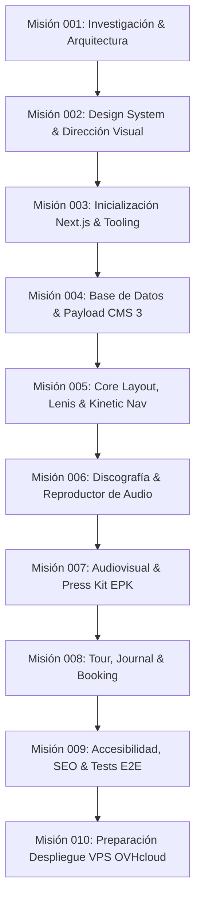

# 07 — Hoja de Ruta (Roadmap) por Misiones Atómicas

El desarrollo del proyecto **Dany Glock — Artist Digital Experience** se estructura en **10 misiones atómicas, secuenciales y comprobables**, diseñadas para garantizar avance continuo sin deuda técnica ni sobreingeniería.

---

---

## Detalle de Misiones

### ✅ Misión 001 — Investigación técnica, arquitectura y preparación del proyecto *(Completada)*
- **Objetivo:** Definir fundamentos, validar viabilidad técnica, auditar entorno, establecer reglas operativas y Project Brain.
- **Entregables:** Diagnóstico de entorno, comparativa de stack, modelos conceptuales de contenido, ADRs iniciales, reglas para agentes y Project Brain inicial en `local/_ai-workspace/`.

---

### ✅ Misión 002 — Design System & Cinematic Art Direction *(Completada técnicamente; validación visual sujeta a conformidad humana)*
- **Objetivo:** Establecer la especificación visual y componentes base del concepto *Dark Cinematic Editorial*.
- **Entregables:**
  - Especificación completa de tokens de diseño semánticos en `04-design-system-strategy.md`.
  - Catálogo de componentes conceptuales y estados accesibles en `10-components.md`.
  - Sistema de movimiento CSS-first y GSAP en `11-motion-system.md`.
  - Arquitectura visual de 8 escenas para la Home en `12-home-visual-architecture.md`.
  - Registros de decisiones arquitectónicas ADR-006, ADR-007 y ADR-008 en `05-technical-decisions.md`.
  - Herramienta de contraste WCAG `local/design-preview/contrast.mjs` y Style Tile `local/design-preview/style-tile.html`.

---

### ✅ Misión 003 — Project Bootstrap & Engineering Foundation *(Completada)*
- **Objetivo:** Inicializar la aplicación real de Next.js 15 App Router, TypeScript estricto, tooling de pruebas y tokens del Design System, garantizando compatibilidad con Payload 3.91.0.
- **Entregables:**
  - Proyecto Next.js 15.4.11 con React 19.3.1 y TypeScript 5.7+ configurado en la raíz del repositorio.
  - Gestión reproducible con `pnpm` y `pnpm-lock.yaml`.
  - Design Tokens semánticos en `src/app/globals.css` y `tailwind.config.ts`.
  - Tipografías autoalojadas con `next/font/google` (`Archivo`, `Instrument Serif`, `JetBrains Mono`).
  - Primitiva accesible `Button` y utilidades de clases `cn` testeadas con Vitest (3/3 tests pasados).
  - Scaffold de verificación técnica en `src/app/(public)/layout.tsx` y `src/app/(public)/page.tsx`.
  - Verificación completa: `tsc --noEmit` limpio, `next lint` limpio, `next build` exitoso en 15s.

---

### ✅ Misión 004 — Base de datos y Payload CMS 3.x *(Completada)*
- **Objetivo:** Integrar el panel de administración de Payload 3.91.0 y modelar las entidades de datos en PostgreSQL 17 con seguridad estricta y tipado estricto.
- **Entregables:**
  - Panel administrativo completamente funcional en `/admin` con autenticación JWT y roles.
  - Conexión a base de datos exclusiva `dany_glock_dev` en PostgreSQL 17 local con migraciones versionadas (20 tablas relacionales).
  - Implementación de 8 colecciones completas (`releases`, `tracks`, `videos`, `events`, `articles`, `media`, `contacts`, `users`).
  - Implementación de 2 globals (`artist-profile`, `site-settings`).
  - Seguridad validada: contactos estrictamente privados (403), borradores ocultos para anónimos (404), operaciones de escritura protegidas.
  - Script de seed de prueba local y tipado completo generado en `src/payload-types.ts`.
  - Verificación total: `tsc`, `lint`, `vitest` y `next build` en PASS.

---

### ✅ Misión 004-B — Security Hardening & CMS Regression Tests *(Completada)*
- **Objetivo:** Auditar, fortalecer la capa de seguridad, rotar credenciales comprometidas y establecer una suite de pruebas automatizadas de regresión en Vitest.
- **Entregables:**
  - Rotación criptográfica de contraseñas y eliminación de credenciales en texto plano en scripts (`seed-admin.ts`, `rotate-admin-password.ts`).
  - Blindaje anti-spam y rate limiting en memoria para el formulario de contacto público.
  - Protección de campo `status` en `contacts` para prevenir inyección anónima.
  - Suite de 14 pruebas automatizadas de regresión en `src/tests/cms-security.test.ts` (17/17 tests totales pasando).
  - Paridad de seguridad certificada en GraphQL y REST.

---

### ✅ Misión 005 — Cinematic Layout & Kinetic Navigation *(Completada)*
- **Objetivo:** Transformar el scaffold técnico en una experiencia pública cinematográfica con navegación editorial, header adaptable al scroll, menú modal nativo accesible y footer conectado al CMS.
- **Entregables:**
  - `SiteHeader`: barra de navegación con wordmark tipográfico póster, desktop links con tracking editorial, scrim/glassmorphism dinámico adaptable al scroll y activación accesible del menú editorial.
  - `EditorialMenu`: menú expandido implementado sobre `<dialog>` nativo con `showModal()`, atrapamiento de foco, soporte nativo de Escape, enlaces tipográficos masivos con numeración mono (`01–06`) y bloque de streaming/booking.
  - `SiteFooter`: Server Component alimentado directamente desde Payload CMS (`artist-profile` y `site-settings`) mediante Local API con reglas de acceso públicas (`overrideAccess: false`), bloque de booking profesional, columnas de navegación/streaming y wordmark gigante con sangrado visual (`15vw`).
  - `PublicRootLayout` y `page.tsx`: integración fluida con skip link accesible (`#main-content`), hero tipográfico editorial temporal y anclas de navegación.
  - Primitiva `Button` polimórfica con soporte nativo para `href` y enlaces de navegación accesibles.
  - Suite automatizada de pruebas de layout y navegación en `src/tests/layout-navigation.test.tsx` (23/23 tests pasando).
  - Verificación visual en navegador desktop (1440x900) y móvil (390x844), y confirmación de aislamiento del panel `/admin`.

---

### ✅ Misión 006-A.1 — Retomar Trabajo Interrumpido y Sembrar Contenido Real en Payload CMS *(Completada)*
- **Objetivo:** Auditar el estado tras interrupción de cuota, extender esquemas CMS con trazabilidad de fuentes (`verificationField`), generar migraciones versionadas y sembrar PostgreSQL con contenido real verificado (discografía, videos, perfiles, biografía editorial) e idempotente.
- **Entregables:**
  - Grupo `verificationField` (`src/fields/verification.ts`) integrado en todas las colecciones y globals.
  - Campos `artistRole`, `coverStatus`, `youtubeId`, `duration`, `slug`, `gallery` y versionado con borradores en `Events`.
  - Migración versionada `20261023_150557_add_artist_data_and_verification.ts` aplicada sin pérdida de datos ni operaciones destructivas.
  - Script idempotente de siembra `src/scripts/seed-artist-data.ts` que puebla 4 lanzamientos verificados publicados, 1 lanzamiento en borrador, 5 canciones, 6 videos oficiales de YouTube, globals corregidos a Pasto/Colombia y 1 evento en borrador (`pasto-vive-flow-2026`).
  - Utilidades robustas de YouTube y slugs en `src/lib/content-utils.ts` con pruebas unitarias (9/9 tests).
  - Suite de regresión y seguridad `src/tests/artist-data-seed.test.ts` (7/7 tests).
  - Verificación de calidad: 39/39 pruebas pasando, `pnpm typecheck` en 0 errores, `pnpm lint` en 0 errores, `pnpm build` exitoso.

---

### ✅ Misión 006-A.2 — Transformar la landing demostrativa en la web oficial de Dany Glock *(Completada)*
- **Objetivo:** Convertir la landing Dark Cinematic Editorial en la web oficial del artista alimentada por Payload CMS y PostgreSQL, eliminando cualquier dato provisional o de scaffolding.
- **Entregables:**
  - Capa de consultas unificada `src/lib/cms-queries.ts` (`getHomePageCmsData`, etc.) con filtrado estricto por publicación y verificación editorial.
  - Landing oficial `src/app/(public)/page.tsx` con Dany Glock como protagonista, origen en Pasto, Colombia, spotlight dinámico de lanzamiento, catálogo discográfico real con vinilo visual para artes en sincronización y distinción de artista invitado en *EXCESO*.
  - Galería de videografía interactiva `src/components/video/VideoGallery.tsx` con modal `<dialog>` y embeds privacy-enhanced (`youtube-nocookie.com`).
  - Estados vacíos editoriales de alta calidad visual para Tour & Shows y Journal sin datos inventados.
  - Formulario de Contacto & Booking accesible `src/components/contact/ContactForm.tsx` con honeypot anti-spam conectado a `/api/contacts`.
  - Saneamiento completo de `EditorialMenu.tsx` y `SiteFooter.tsx` (cero menciones a Guatemala ni correos inventados).
  - Configuración de `push: false` en `payload.config.ts` y saneamiento de registros dev en migraciones.
  - Suite de pruebas de integración `src/tests/public-views.test.tsx` (16 pruebas pasando; total 55 pruebas en el repo).
  - Compilación Next.js 15 de producción exitosa al 100% (First Load JS 119 kB).

---

### ✅ Misión 006-B.1 — Cinematic Artist Experience & Home Redesign *(Completada)*
- **Objetivo:** Rediseñar la Home como una experiencia digital cinematográfica, editorial y auténtica para Dany Glock, alimentada exclusivamente por Payload CMS y PostgreSQL.
- **Entregables:**
  - Expansión de `ArtistProfile` con campos administrables para Hero desktop (16:9), Hero mobile (9:16), video de fondo, retrato editorial (4:5), títulos y CTAs.
  - Migración versionada `src/migrations/20261023_180000_add_hero_and_portrait_media.ts` ejecutada y registrada formalmente.
  - Hero asimétrico de gran escala con wordmark `DANY GLOCK`, identidad territorial (*Pasto, Colombia*) y canvas cinematográfico.
  - Single Spotlight dedicado para el último lanzamiento (*Cicatrices feat. Maick Records*).
  - Discografía editorial asimétrica distinguiendo artista principal vs. invitado (*EXCESO*).
  - Sección editorial "El Artista — Biografía" en Home y ruta completa `/biografia` con narrativa y ficha técnica verificada.
  - Videografía con jerarquía visual (video principal spotlight + cuadrícula) y modal HTML5 `<dialog>`.
  - Shows con estado editorial elegante sin fechas inventadas.
  - Formulario de contacto y booking unificado con protección anti-spam.
  - Simplificación radical del footer (eliminación de enlace a `/admin` y correos inventados).
  - Erradicación total de textos técnicos y de desarrollo (`Artist Digital Experience`, `Dark Cinematic Editorial`, `Fase 005`).
  - Suite de 18 pruebas en `src/tests/public-views.test.tsx` (57 de 57 pruebas totales pasando).
  - 100% de calidad: `typecheck` 0 errores, `lint` 0 errores/warnings, `build` exitoso, verificación visual desktop y móvil.

---

### ✅ Misión 006-B.2 — Official Artist Visual Identity & Media Experience *(Completada)*
- **Objetivo:** Elevar la identidad visual de Dany Glock con una arquitectura multimedia responsiva, editorial y administrable en Payload CMS, respetando accesibilidad, rendimiento y fallbacks cinemáticos.
- **Entregables:**
  - `HeroMedia.tsx`: Integración responsiva de medios de fondo (desktop 16:10 / 16:9 y móvil 9:16 / 4:5), soporte de video opcional en bucle silenciado, control accesible de pausa/reproducción, detección de `prefers-reduced-motion` y fallback Dark Cinematic Editorial.
  - `ReleaseCover.tsx`: Estandarización de carátulas 1:1 cuadradas con `<Image>` de Next.js, carga prioritaria para spotlight, lazy loading para catálogo y fallback de vinilo concéntrico con código de catálogo.
  - `ArtistPortrait.tsx`: Componente vertical 4:5 integrado en Home ("El Artista") y `/biografia` con fallback editorial y tipografía monumental.
  - `VideoGallery.tsx`: Priorización de `customThumbnail` sobre la miniatura automática de YouTube, modal `<dialog>` accesible con atrapamiento de foco y cero iframes en carga inicial.
  - `next.config.ts`: Formatos modernos `image/avif`, `image/webp` y dominios remotos de YouTube autorizados.
  - `cms-queries.ts`: `depth: 2` para poblar exhaustivamente relaciones de `Media`.
  - Quality Gates certificados: 63/63 tests pasando en Vitest, typecheck 0, lint 0, build Next.js 15 en PASS, verificación visual en navegador desktop y móvil.

---

### ⏳ Misión 007 — Audiovisual, videoclips y Electronic Press Kit (EPK)
- **Objetivo:** Presentar el universo visual del artista y herramientas para la prensa y medios.
- **Alcance:**
  - Galería de videoclips con reproductor modal optimizado y créditos de dirección.
  - Sección interactiva de Electronic Press Kit (EPK).
  - Descargas de fotos de prensa en alta resolución con previsualización rápida.
  - Biografía oficial descargable en PDF y versiones de texto para programas de festivales.

---

### ⏳ Misión 008 — Eventos / Tour, Journal y Booking / Contacto
- **Objetivo:** Gestionar presentaciones en vivo, noticias y canal directo de negocio.
- **Alcance:**
  - Calendario de conciertos y festivales con estado de tickets (*Sold Out*, *Preventa*).
  - Journal editorial con artículos y comunicados oficiales.
  - Formulario de contacto segmentado (Booking, Prensa, Patrocinios) con validación estricta y protección anti-spam.

---

### ⏳ Misión 009 — Optimización, accesibilidad (a11y), SEO y pruebas E2E
- **Objetivo:** Pulir y certificar la calidad integral de la plataforma antes del empaquetado final.
- **Alcance:**
  - Auditoría completa de accesibilidad WCAG 2.1 AA con Playwright y axe-core.
  - Optimización de Core Web Vitals (LCP < 2s, CLS < 0.05).
  - Metadatos OpenGraph, Twitter Cards, Schema.org de tipo `MusicGroup` y `MusicAlbum`.
  - Verificación estricta de `prefers-reduced-motion` en todos los navegadores.

---

### ⏳ Misión 010 — Preparación de despliegue en VPS (OVHcloud)
- **Objetivo:** Dejar la plataforma empaquetada y documentada para su puesta en producción sin complicaciones.
- **Alcance:**
  - Generación de `Dockerfile` multi-stage optimizado para Next.js en modo standalone.
  - Configuración de script de migraciones de PostgreSQL para entorno de producción.
  - Archivo de configuración modelo para Nginx (Reverse Proxy + SSL Let's Encrypt).
  - Manual operativo de despliegue, copias de seguridad de base de datos y restauración.

### ✅ Misión 006-B.3 — Revalidación del CMS sin rebuild *(Completada y desplegada, `d6bd589`)*
- ISR con revalidación bajo demanda desde hooks de Payload; endpoint `POST /api/revalidate` solo admin. Ver `16-cache-revalidation.md`.

### ✅ Misión 006-B.4 — Imágenes oficiales *(Completada y desplegada, `329157f`)*
- 4 portadas oficiales y retrato del canal oficial en producción; medios reales sin superposiciones. Ver `17-media-inventory.md`.

### ⏳ Siguiente
- Fotos de prensa en alta resolución (MED-05/06), aprobaciones editoriales del brochure (BRO-01…09) y Misión 007.
