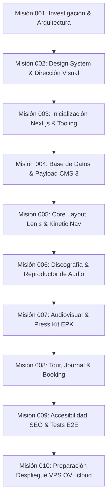

# 07 — Hoja de Ruta (Roadmap) por Misiones Atómicas

El desarrollo del proyecto **Dany Glock — Artist Digital Experience** se estructura en **10 misiones atómicas, secuenciales y comprobables**, diseñadas para garantizar avance continuo sin deuda técnica ni sobreingeniería.

---

---

## Detalle de Misiones

### ✅ Misión 001 — Investigación técnica, arquitectura y preparación del proyecto *(Completada)*
- **Objetivo:** Definir fundamentos, validar viabilidad técnica, auditar entorno, establecer reglas operativas y Project Brain.
- **Entregables:** Diagnóstico de entorno, comparativa de stack, modelos conceptuales de contenido, ADRs iniciales, reglas para agentes y Project Brain inicial en `local/_ai-workspace/`.

---

### ✅ Misión 002 — Design System & Cinematic Art Direction *(Completada técnicamente; validación visual sujeta a conformidad humana)*
- **Objetivo:** Establecer la especificación visual y componentes base del concepto *Dark Cinematic Editorial*.
- **Entregables:**
  - Especificación completa de tokens de diseño semánticos en `04-design-system-strategy.md`.
  - Catálogo de componentes conceptuales y estados accesibles en `10-components.md`.
  - Sistema de movimiento CSS-first y GSAP en `11-motion-system.md`.
  - Arquitectura visual de 8 escenas para la Home en `12-home-visual-architecture.md`.
  - Registros de decisiones arquitectónicas ADR-006, ADR-007 y ADR-008 en `05-technical-decisions.md`.
  - Herramienta de contraste WCAG `local/design-preview/contrast.mjs` y Style Tile `local/design-preview/style-tile.html`.

---

### ✅ Misión 003 — Project Bootstrap & Engineering Foundation *(Completada)*
- **Objetivo:** Inicializar la aplicación real de Next.js 15 App Router, TypeScript estricto, tooling de pruebas y tokens del Design System, garantizando compatibilidad con Payload 3.91.0.
- **Entregables:**
  - Proyecto Next.js 15.4.11 con React 19.3.1 y TypeScript 5.7+ configurado en la raíz del repositorio.
  - Gestión reproducible con `pnpm` y `pnpm-lock.yaml`.
  - Design Tokens semánticos en `src/app/globals.css` y `tailwind.config.ts`.
  - Tipografías autoalojadas con `next/font/google` (`Archivo`, `Instrument Serif`, `JetBrains Mono`).
  - Primitiva accesible `Button` y utilidades de clases `cn` testeadas con Vitest (3/3 tests pasados).
  - Scaffold de verificación técnica en `src/app/(public)/layout.tsx` y `src/app/(public)/page.tsx`.
  - Verificación completa: `tsc --noEmit` limpio, `next lint` limpio, `next build` exitoso en 15s.

---

### ✅ Misión 004 — Base de datos y Payload CMS 3.x *(Completada)*
- **Objetivo:** Integrar el panel de administración de Payload 3.91.0 y modelar las entidades de datos en PostgreSQL 17 con seguridad estricta y tipado estricto.
- **Entregables:**
  - Panel administrativo completamente funcional en `/admin` con autenticación JWT y roles.
  - Conexión a base de datos exclusiva `dany_glock_dev` en PostgreSQL 17 local con migraciones versionadas (20 tablas relacionales).
  - Implementación de 8 colecciones completas (`releases`, `tracks`, `videos`, `events`, `articles`, `media`, `contacts`, `users`).
  - Implementación de 2 globals (`artist-profile`, `site-settings`).
  - Seguridad validada: contactos estrictamente privados (403), borradores ocultos para anónimos (404), operaciones de escritura protegidas.
  - Script de seed de prueba local y tipado completo generado en `src/payload-types.ts`.
  - Verificación total: `tsc`, `lint`, `vitest` y `next build` en PASS.

---

### ✅ Misión 004-B — Security Hardening & CMS Regression Tests *(Completada)*
- **Objetivo:** Auditar, fortalecer la capa de seguridad, rotar credenciales comprometidas y establecer una suite de pruebas automatizadas de regresión en Vitest.
- **Entregables:**
  - Rotación criptográfica de contraseñas y eliminación de credenciales en texto plano en scripts (`seed-admin.ts`, `rotate-admin-password.ts`).
  - Blindaje anti-spam y rate limiting en memoria para el formulario de contacto público.
  - Protección de campo `status` en `contacts` para prevenir inyección anónima.
  - Suite de 14 pruebas automatizadas de regresión en `src/tests/cms-security.test.ts` (17/17 tests totales pasando).
  - Paridad de seguridad certificada en GraphQL y REST.

---

### ⏳ Misión 005 — Core Layout, Smooth Scroll & Kinetic Navigation *(Siguiente fase activa)*
- **Objetivo:** Desarrollar el marco estructural envolvente de la experiencia pública.
- **Alcance:**
  - Root Layout con integración de Server Components y tipografías personalizadas.
  - Implementación del proveedor de smooth scroll inercial con Lenis y ticker de GSAP.
  - Barra de navegación flotante cinemática con efectos de blur y estado adaptativo al scroll.
  - Menú lateral editorial desplegable con transiciones de Motion.
  - Footer cinematográfico con créditos, redes sociales y manifiesto.

---

### ⏳ Misión 006 — Discografía, reproductor y lanzamientos
- **Objetivo:** Construir la experiencia musical central para los fans.
- **Alcance:**
  - Hero Showcase del último lanzamiento con preview audiovisual y CTAs de streaming.
  - Catálogo de discografía con filtros por tipo (Álbum, EP, Single).
  - Ficha detallada de lanzamiento con carátula fija (*pinned scroll*), tracklist y créditos.
  - Reproductor de audio flotante persistente con control de reproducción, volumen, scrubber y visualizador de onda sonora accesible.

---

### ⏳ Misión 007 — Audiovisual, videoclips y Electronic Press Kit (EPK)
- **Objetivo:** Presentar el universo visual del artista y herramientas para la prensa y medios.
- **Alcance:**
  - Galería de videoclips con reproductor modal optimizado y créditos de dirección.
  - Sección interactiva de Electronic Press Kit (EPK).
  - Descargas de fotos de prensa en alta resolución con previsualización rápida.
  - Biografía oficial descargable en PDF y versiones de texto para programas de festivales.

---

### ⏳ Misión 008 — Eventos / Tour, Journal y Booking / Contacto
- **Objetivo:** Gestionar presentaciones en vivo, noticias y canal directo de negocio.
- **Alcance:**
  - Calendario de conciertos y festivales con estado de tickets (*Sold Out*, *Preventa*).
  - Journal editorial con artículos y comunicados oficiales.
  - Formulario de contacto segmentado (Booking, Prensa, Patrocinios) con validación estricta y protección anti-spam.

---

### ⏳ Misión 009 — Optimización, accesibilidad (a11y), SEO y pruebas E2E
- **Objetivo:** Pulir y certificar la calidad integral de la plataforma antes del empaquetado final.
- **Alcance:**
  - Auditoría completa de accesibilidad WCAG 2.1 AA con Playwright y axe-core.
  - Optimización de Core Web Vitals (LCP < 2s, CLS < 0.05).
  - Metadatos OpenGraph, Twitter Cards, Schema.org de tipo `MusicGroup` y `MusicAlbum`.
  - Verificación estricta de `prefers-reduced-motion` en todos los navegadores.

---

### ⏳ Misión 010 — Preparación de despliegue en VPS (OVHcloud)
- **Objetivo:** Dejar la plataforma empaquetada y documentada para su puesta en producción sin complicaciones.
- **Alcance:**
  - Generación de `Dockerfile` multi-stage optimizado para Next.js en modo standalone.
  - Configuración de script de migraciones de PostgreSQL para entorno de producción.
  - Archivo de configuración modelo para Nginx (Reverse Proxy + SSL Let's Encrypt).
  - Manual operativo de despliegue, copias de seguridad de base de datos y restauración.
