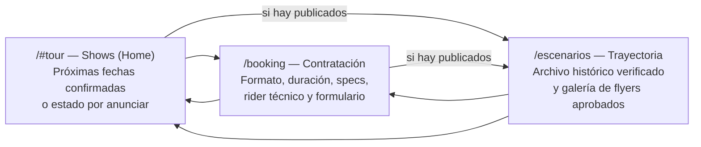

# 19 — Mapa Definitivo de Rutas, Shows y Navegación (Misión 006-C.3)

**Fecha:** 2026-11-20 · **Estado:** completada y validada en local (sin commit, push ni despliegue).

---

## 1. Arquitectura de rutas públicas

| Ruta / Ancla | Función | Visibilidad | Renderizado / ISR |
| :--- | :--- | :--- | :--- |
| `/` | Home oficial: Hero, Último lanzamiento (`#lanzamiento`), Discografía (`#musica`), El Artista (`#biografia`), Videografía (`#videos`), Shows & Presentaciones (`#tour`), Prensa/EPK/Contacto (`#contacto`, `#press-kit`) | Pública | Estática + ISR 1 h + hooks |
| `/biografia` | Perfil artístico completo, ficha técnica, discografía de referencia, trayectoria/colaboraciones (`career-highlights`), bloque En Vivo y avance de 3 eventos de trayectoria (si hay publicados) | Pública | Estática + ISR 1 h + hooks |
| `/booking` | Contratación profesional: descripción del show, duración, formato, género, público, especificaciones técnicas / rider (`technicalRider`), tipos de evento, contacto autorizado de management, formulario de solicitud (`#cotizacion`) y puente discreto hacia `/#tour` y `/escenarios` (si hay publicados). **Sin galería de flyers.** | Pública | Estática + ISR 1 h + hooks |
| `/escenarios` | Trayectoria en escenarios: galería responsive de eventos históricos publicados/verificados, flyers aprobados completos (`object-contain`), visor ampliado `<dialog>`, acceso a `/#tour` y `/booking`. | **Condicional** (404 si hay 0 eventos de archivo publicados y verificados) | Estática + ISR 1 h + hooks (`events: '*'`) |
| `/epk` | Electronic Press Kit para medios/promotores. | **Privada** (404 mientras `press-kit.isPublic = false`) | Estática + ISR 1 h + hooks |
| `/admin` | Panel administrativo de Payload CMS 3 (sin enlace público en Header, Menú ni Footer). | Privada (autenticación JWT) | Dinámica (`ƒ`) |

---

## 2. Separación de responsabilidades en Shows en vivo

- **`/#tour` (Home):** exclusivamente próximos shows confirmados (`listing !== 'archive'`, `_status = published`, `verification = verified`, `date >= now`) o estado vacío editorial; ofrece siempre acceso a `/booking` (incluso cuando haya próximas fechas) y a `/escenarios` cuando existan eventos históricos publicados.
- **`/booking`:** centrada 100% en contratación profesional. Se retiró el bloque `ShowGallery` («02 / Archivo de presentaciones») para no convertir Booking en una galería de flyers; se añadió el bloque de **Requerimientos técnicos / rider** y el puente discreto hacia `/escenarios` cuando haya archivo publicado.
- **`/escenarios`:** repositorio único de eventos históricos aprobados y sus flyers con control de derechos y protección de archivos privados.

---

## 3. Navegación unificada (`src/lib/navigation.ts`)

Fuente única de verdad compartida por **Header de escritorio**, **Menú Editorial (móvil/overlay)** y **Footer**:

| # | Etiqueta | Destino | ID / Ruta verificada | Header escritorio | Menú Editorial / Móvil | Footer |
| :-: | :--- | :--- | :--- | :-: | :-: | :-: |
| 01 | **Música** | `/#musica` | `id="musica"` en `page.tsx` | ✅ | ✅ | ✅ |
| 02 | **Videos** | `/#videos` | `id="videos"` en `page.tsx` | ✅ | ✅ | ✅ |
| 03 | **El artista** | `/biografia` | `app/(public)/biografia/page.tsx` | ✅ | ✅ | ✅ |
| 04 | **Shows** | `/#tour` | `id="tour"` en `page.tsx` | ✅ | ✅ | ✅ |
| 05 | **Trayectoria** | `/escenarios` | `app/(public)/escenarios/page.tsx` | ✅ *(solo si hay publicados)* | ✅ *(solo si hay publicados)* | ✅ *(solo si hay publicados)* |
| 06 | **Booking** | `/booking` | `app/(public)/booking/page.tsx` | CTA derecha (`Booking ↗`) | ✅ | ✅ |
| 07 | **Contacto** | `/#contacto` | `id="contacto"` en `page.tsx` | ✅ | ✅ | ✅ |

> Nota sobre el ancla de Música: el ID real en `src/app/(public)/page.tsx` es `id="musica"` (en español, consistente con toda la app), por lo que el enlace verificado es `/#musica` (no `/#music`).

### Correcciones aplicadas en navegación y accesibilidad

1. **Eliminado enlace roto `/#journal`** en `EditorialMenu.tsx` (resuelve **INT-04**).
2. **Paridad completa** entre escritorio, menú móvil/editorial y footer:
   - `El artista` apunta ahora a `/biografia` en los tres espacios (antes escritorio apuntaba a `/#biografia` y el menú editorial omitía por completo Biografía).
   - `Trayectoria` (`/escenarios`) aparece dinámicamente vía ISR en Header de escritorio, Menú Editorial y Footer solo cuando hay eventos históricos publicados.
   - `Booking` (`/booking`) añadido al Footer y conservado como CTA en el Header y entrada dedicada en el Menú Editorial.
   - Eliminada la entrada redundante `/#press-kit` del Menú Editorial (la tarjeta EPK sigue disponible en `/#contacto` y enlaza a `/epk` únicamente cuando `pressKit.isPublic = true`).
3. **UX móvil y teclado:** `EditorialMenu` cierra al hacer clic en enlace, con `Escape`, al hacer clic en el backdrop y automáticamente ante cambios de ruta (`usePathname` en `SiteHeader`), devolviendo el foco al botón `Menú`. Breakpoint de barra inline ajustado a `lg:` para evitar apiñamiento en tablet con 6 enlaces.
4. **Jerarquía semántica y movimiento reducido:** corregidos saltos `h2 → h4` a `h3` en Discografía y Ecosistema Digital de la Home; `motion-reduce:animate-none` añadido a indicadores con `animate-pulse`; enlace `← Volver a la Página Principal` añadido en `/epk`.
5. **Eficiencia de consultas Payload:**
   - `layout.tsx` obtiene `site-settings`, `artist-profile` y el conteo de archivo en un único `Promise.all` y los pasa a `SiteHeader` y `SiteFooter`, eliminando las consultas duplicadas de `SiteFooter`.
   - `HomePage` ejecuta sus consultas en un único `Promise.all` sin la consulta muerta a `articles` (que no se renderizaba en Home).
   - `BookingPage` reemplaza `getShowGalleryData()` por `getStageHistoryData()` (solo para el puente discreto a `/escenarios`).
   - `CONTENT_DEPENDENCIES['artist-profile']` ampliado a `['/', '/biografia', '/booking', '/epk', '/escenarios']` para mantener el footer sincronizado en todas las rutas.

---

## 4. Componentes y archivos modificados

- **Nuevo:** `src/lib/navigation.ts`
- **Layout y navegación:** `src/app/(public)/layout.tsx`, `src/components/layout/SiteHeader.tsx`, `src/components/layout/EditorialMenu.tsx`, `src/components/layout/SiteFooter.tsx`
- **Páginas y componentes:** `src/app/(public)/page.tsx`, `src/app/(public)/booking/page.tsx`, `src/app/(public)/escenarios/page.tsx`, `src/app/(public)/epk/page.tsx`, `src/components/music/LatestReleaseSpotlight.tsx`, `src/lib/revalidate.ts`
- **Pruebas y E2E:** `src/tests/layout-navigation.test.tsx`, `src/tests/stage-history.test.tsx`, `src/tests/brochure-content.test.tsx`, `src/scripts/verify-stage-history.ts`

---

## 5. Validación ejecutada (2026-11-20)

- `pnpm typecheck`: 0 errores · `pnpm lint`: 0 errores/warnings.
- `pnpm test` (Vitest): **119/119** (9 suites; 9 pruebas en `layout-navigation.test.tsx` incluyendo verificación programática de que cada ancla `/#*` existe como `id="..."` en `page.tsx`).
- `pnpm build`: OK (`/booking` bajó de 122 kB a **117 kB** First Load JS; las 5 rutas públicas en ISR 1 h).
- E2E contra `next start` local (`127.0.0.1:3007`):
  - `verify-stage-history.ts`: **28/28** (rutas con/sin publicados, `/booking` sin galería de flyers, privacidad de flyers originales/redimensionados/`/_next/image`, GraphQL, REST, EPK 404).
  - `verify-revalidation.ts`: **13/13**.
- QA real en navegador (Chrome headless vía CDP en **1440×900** y **375×812**): **52/52** — 0 overflow horizontal en `/`, `/biografia`, `/booking` y `/escenarios`; 1 `h1` y 0 saltos de encabezado por ruta; menú móvil abre, muestra 6 enlaces sin publicados / 7 con publicados, navega `/booking → /#tour` y cierra `<dialog>`; escritorio navega `/biografia → /#musica` al ancla real.
- Estado final en BD local: **18/18** eventos en borrador, **32/32** medios `event_flyer`/`live_photo` ocultos/pendientes, **0** legibles por anónimos, `/epk` 404, `/escenarios` 404.

---

## 6. Riesgos, pendientes y despliegue

- **Sin cambios de esquema ni dependencias:** M006-C.3 no añade migraciones ni paquetes; se despliega junto con M006-C + M006-C.1 siguiendo `14-vps-deployment.md` §11.
- **Pendientes heredados:** `ShowGallery.tsx` y `getShowGalleryData()` se conservan intactos por compatibilidad con tests de M006-B.2 y futura reutilización (p. ej. fotos en vivo en prensa/EPK), pero ya no se muestran en `/booking`.
- **Pendiente editorial:** STG-01 (aprobación de eventos históricos), BRO-01…BRO-09, MED-05/06.

